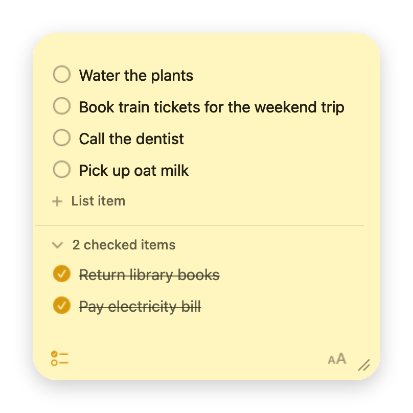

# Sticky Note

A post-it note that lives on your macOS desktop, styled like the built-in widgets. Click into it and type.



macOS widgets (WidgetKit) can't take keyboard input, so this is a small borderless app window that sits at desktop level instead: behind your other windows, on every Space, with no Dock icon.

## Install

Requires macOS 13 or later, on Apple Silicon or Intel.

1. Download `Sticky-Note.zip` from the [latest release](https://github.com/bennycode/sticky-note/releases/latest) and unzip it.
2. Move `Sticky Note.app` to `/Applications`.
3. Open it.

The app isn't notarized by Apple, so macOS blocks the first launch. To allow it, go to **System Settings → Privacy & Security**, scroll down and click **Open Anyway**. Or remove the download flag in Terminal:

```sh
xattr -dr com.apple.quarantine "/Applications/Sticky Note.app"
```

## Build from source

Requires the Xcode command line tools.

```sh
./build.sh
open "build/Sticky Note.app"
```

## Development

Set `STICKY_NOTE_DIR` to run a build against test data instead of your real note:

```sh
STICKY_NOTE_DIR=/tmp/test-note "build/Sticky Note.app/Contents/MacOS/StickyNote"
```

Run the checks with `./test.sh`.

## Usage

- **Type:** click anywhere in the note.
- **Move:** drag the strip along the top edge.
- **Resize:** drag the grip in the bottom-right corner, or any edge.
- **Checklist:** click the checkbox icon in the bottom-left corner, or press <kbd>⇧</kbd> <kbd>⌘</kbd> <kbd>L</kbd>. Each line becomes an item, and markers like `- ` or `[x] ` are picked up.
  - <kbd>Return</kbd> starts a new item (splitting the current one at the caret).
  - <kbd>⌫</kbd> at the start of an item merges it into the one above, or removes it when empty.
  - <kbd>↑</kbd> <kbd>↓</kbd> move between items.
  - Drag an item to reorder it. While you are editing it, drag the ☰ handle on its left instead.
  - Checked items move into a collapsible "checked items" section at the bottom.
- **Eisenhower matrix:** click the grid icon in the bottom-left corner, or press <kbd>⇧</kbd> <kbd>⌘</kbd> <kbd>M</kbd>. Open items split into "Do first", "Schedule", "Delegate" and "Don't do", with everything you haven't placed yet under "Unsorted".
  - Drag an item into another quadrant to re-prioritize it.
  - Make the note wider and the quadrants sit two across; narrow, they stack.
  - Switching back to the plain list keeps each item's quadrant.
- **Text size:** click the "aA" icon in the bottom-right corner, or use <kbd>⌘</kbd> <kbd>+</kbd>, <kbd>⌘</kbd> <kbd>−</kbd> and <kbd>⌘</kbd> <kbd>0</kbd>.
- **Options:** right-click the top strip for "Show/Hide Checkboxes", "Eisenhower Matrix", "Open at Login" and "Quit".
- **Quit:** <kbd>⌘</kbd> <kbd>Q</kbd> while the note is focused, or use the right-click menu.

Your note is saved as you type to `~/Library/Application Support/StickyNote/note.json`. Window position and size are remembered too.

## License

[MIT](LICENSE)
